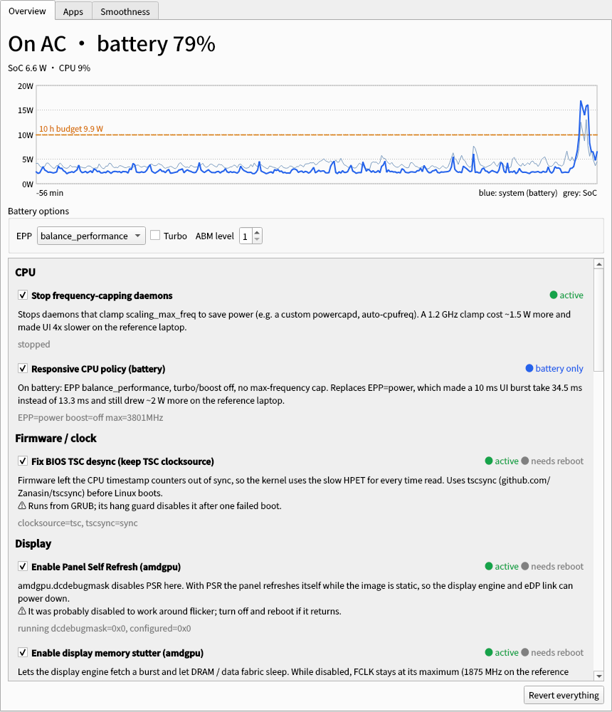

# Endura

**为 Linux 笔记本设计的、每一项都经过实测且可还原的续航调优工具（带图形界面）。**

[English](README.md)

Endura 由一个 root 守护进程、两个用户级代理和一个 PyQt6 图形界面组成。它提供的每项调优都在真实硬件上
**做过 A/B 实测**，可以逐项开关；同时记录每个应用的 CPU 时间和唤醒次数，让你看清电到底耗在哪里。

它源于对一台笔记本的排查：那台机器此前被"优化"成把 CPU 锁在 1.2GHz，续航却只有约 6 小时。
经过下面这些工作后，同一台机器在**屏幕 30% 亮度、所有常用应用开着的静置状态下只有 4.4W**
（99Wh 电池约 22 小时），而且比之前更流畅。详见[调优案例](#调优案例)。



## 功能与实测收益

| 调优项 | 做了什么 | 实测效果（参考机） |
|---|---|---|
| **响应式 CPU 策略**（电池） | EPP 用 `balance_performance`、关睿频、不限最高频，替代省电模式的 EPP `power` | 平均 **−2.07W**（8 轮 A/B），且 10ms UI 任务 34.5→13.3ms |
| **停用压频守护进程** | 停掉压低 `scaling_max_freq` 的守护进程 | 去掉 1.2GHz 锁频：**−1.5W**，UI 快 3 倍 |
| **TSC 同步**（AMD，借助 [tscsync](https://github.com/Zanasin/tscsync)） | 固件让 CPU0 的 TSC 落后约 0.8 秒，内核退回 HPET；tscsync 在启动前校准 | 时钟源回到 `tsc`，`clock_gettime()` 重新走 vDSO，不再是系统调用 + HPET 读 |
| **面板自刷新 PSR / 显示内存 stutter**（amdgpu） | 用覆盖文件撤销旧的 `amdgpu.dcdebugmask=0x12` 规避参数 | 空闲 FCLK 1875→400MHz；静止画面 PSR 驻留 0→约 90% |
| **静音音频流闸门** | 持续输出纯数字静音的流挪到虚拟声卡，让声卡和功放挂起；有真实声音约 0.2 秒切回 | **−1.2W**（某浏览器标签页播放了数小时静音） |
| **App Nap**（电池） | 失焦的聊天应用按 2 秒冻结/0.4 秒运行节流；5 分钟无输入后聊天应用和浏览器约 9 秒冻结/0.4 秒运行；切换窗口或任何键鼠输入约 40ms 恢复；有音视频的应用不节流 | 聊天应用在后台 **−0.40W**；静置 **5.1→4.4W** |
| **用电池时隐藏 Plasma 面板系统监视器** | 面板上的 CPU/网络/磁盘图表让屏幕每秒重绘约 55 次，PSR 永远进不去 | 静止画面重绘 55→0 次/秒 |
| **自适应 timer slack** | 以 10ms 定时器空转轮询的守护进程获得 500ms（远控类）或 50ms 的 slack；事件仍即时唤醒；远控会话开始约 10 秒内恢复 | 向日葵 586→16 次/秒，ToDesk 608→104 次/秒 |
| **合并磁盘写入**（电池） | btrfs/ext4 `commit=120,noatime`、脏页 60 秒过期（运行时重挂载，不改 fstab） | NVMe 写入 3443→1541 次/分钟 |
| **忙等进程监控** | 应用持续 3 分钟每秒唤醒超过 1500 次时通知 | 抓到某聊天应用后台约 3000 次/秒唤醒，多耗 **约 4W** |
| **崩溃循环守卫** | 停掉 10 分钟内重启超过 20 次的服务 | 抓到一个 npm 依赖缺失的更新器，已重启 1286 次 |
| **厂商服务修复** | 声明 `Type=forking` 却从不 fork 的服务（启动超时→无限重启） | 某远控守护进程已重启 113 次 |
| PCI 运行时电源管理、ASPM `powersupersave`、关 NMI watchdog、精简后台服务、浏览器省电策略 | 常规项 | 收益小，但没有代价 |

测过但**未采用**（参考机上测不出收益）：AMD ABM 1/3 级、120Hz+VRR 对比 60Hz、关闭 SMT、
蓝牙 USB 自动挂起、对聊天应用加 cgroup CPU 配额（配额挡不住唤醒，只有冻结才有效）。

## 流畅度标准

不允许靠让机器变卡来省电。Endura 的标准（`endura-bench` 检测）：

> 从空闲开始，一段在最高性能下耗时 10ms 的 UI 类任务，**p90 ≤ 16.7ms**（60Hz 一帧）；
> 2ms 任务 **p90 ≤ 8.3ms**（120Hz 一帧）。

| 策略 | 2ms 任务 p50 | 10ms 任务 p50 | 结论 |
|---|---|---|---|
| EPP performance + 睿频（参照） | 2.3ms | 10.7ms | — |
| EPP `balance_performance`、关睿频（**Endura**） | 3.0ms | 13.3ms | 通过 |
| EPP `balance_power` | 4.8ms | 21.3ms | 不通过 |
| EPP `power`（常见省电模式） | 6.9ms | 34.5ms | 不通过 |
| EPP `power` + 1.2GHz 锁频 | 8.0ms | 39.8ms | 不通过 |

## 遥测与工具

* **总览**：实时整机与 SoC 功耗、1 小时曲线、每项调优的状态（生效中 / 仅电池 / 需重启 / 本机不支持）。
* **应用耗电**：1 小时到 7 天内（仅电池时段）每个应用的 CPU 时间和**每秒唤醒次数**，以及**冻结实测**：
  反复冻结/解冻某个应用的 cgroup，测出它的真实功耗。唤醒往往比 CPU% 更重要：
  一个 CPU 只有 3% 但每秒唤醒 3000 次的后台进程耗了 4W。
* **流畅度**：运行上面的基准测试。
* [`lab/`](lab/) 是本页所有数字所用的 A/B 测量脚本。

## 运行要求

* systemd、cgroup v2、Python 3.10+、PyQt6、pulsectl、dbus-python、PyGObject、PipeWire（pulse 兼容层）
* `/sys/class/power_supply` 中有电池的笔记本
* 支持最完整：AMD Ryzen APU（SoC 功耗遥测、amdgpu PSR、TSC 修复）和 KDE Plasma 6 Wayland
  （App Nap 的焦点跟踪、隐藏面板监视器）。通用项在 Intel 和其他桌面同样可用；硬件不具备的项会显示为"不可用"。

## 安装

从 PyPI 安装：

```sh
pipx install endura                # 或 pip install --user endura
sudo "$(which endura-install)"     # 安装依赖（dnf / apt / pacman）、守护进程和图形界面
endura-gui                         # 或从应用菜单打开 "Endura"
```

从源码安装：

```sh
git clone https://github.com/qvictl/endura.git
cd endura
sudo ./install.sh
```

系统服务运行在 `/usr/lib/endura` 下的独立副本上，使用发行版自带的 `/usr/bin/python3`，与 pip 把包装到哪里无关。

大多数调优默认开启且只在用电池时生效。需要重启的项（TSC 同步、PSR、stutter）默认关闭，在 GUI 中开启。
TSC 修复需先安装 [tscsync](https://github.com/Zanasin/tscsync)，Endura 只负责开关它。

```sh
sudo "$(which endura-uninstall)"   # 或 ./uninstall.sh：先还原所有调优，再卸载
```

调优修改过的文件都备份在 `/var/lib/endura/backup`；内核模块参数写在独立的覆盖文件
（`/etc/modprobe.d/zz-endura-amdgpu.conf`），不改动你原有的配置。

## 配置

`/etc/endura/config.json` 示例见英文 README；全部键和默认值见 [`endura/defaults.py`](endura/defaults.py)。
`nap_apps` 按应用的 systemd cgroup 匹配（flatpak scope、KDE/GNOME 的 `app-*.service`）；
tier 1 失焦即节流，tier 2 只在 5 分钟无输入后节流。

## 调优案例

参考机：**联想 ThinkBook 14 G8+ AHP**——AMD Ryzen 7 H 255（Zen 4，Radeon 780M）、32GB LPDDR5X、
3072×1920 120Hz IPS 屏、Intel AX210、99.9Wh 电池、Fedora 43、KDE Plasma 6 Wayland、内核 7.0。
必须常开的应用：飞书、Chrome、向日葵、Discord、v2rayN、微信。约束：Wi-Fi 和蓝牙开启、亮度 30%、不能牺牲流畅度。

**起点。** 之前的"优化"用反馈环不断压低 `scaling_max_freq`，直到电池功耗低于 12W，同时给聊天应用加 cgroup CPU 配额。
结果整天停在 1.2GHz 下限，整机仍然 14~16W，续航约 6 小时；10ms 的 UI 任务要 40ms。

**按发现顺序的排查过程**（整机电池功耗 A/B，亮屏、应用开着，除非另有说明）：

1. **锁频适得其反。** 去掉锁频反而省约 1.5W：核心慢，停在 C0 的时间更长，总线也一直醒着。
   接着是省电模式的 EPP `power`：换成 `balance_performance` 关睿频，**−2.07W 且快 2.6 倍**。
2. **某浏览器标签页播放了数小时数字静音**，让声卡和功放一直通电：把流挪到虚拟声卡省 1.2W，由此做了静音闸门。
3. **内核在用 HPET。** dmesg：`Measured 3168609404 cycles TSC warp between CPUs, turning off TSC clock`。
   BIOS 启动时 CPU0 比其余 15 个线程慢约 0.8 秒，AMD 没有 TSC_ADJUST。每次 `clock_gettime()` 都变成系统调用
   加一次慢速 MMIO 读（某聊天应用后台每秒 3000 次）。用 tscsync 修复，启动后各核偏差 ±16 个周期。
4. **`amdgpu.dcdebugmask=0x12`**（旧的闪屏规避参数）同时禁用了 PSR 和显示内存 stutter，FCLK 被钉在 1875MHz。
   重新启用后空闲降到 400MHz，目前没有闪屏。
5. **某聊天应用的后台进程陷入忙等**：它的 Rust 任务调度器每 5ms 唤醒 15 个工作线程（CPU 3%，每秒约 3000 次唤醒）。
   只冻结这一个进程，整机就从 14.8W 降到 10.1W——**一个进程约 4W**。升级并重启后恢复正常；
   之前用的 cgroup CPU 配额毫无作用，因为配额挡不住唤醒。
6. **某远控守护进程卡在启动超时循环里**（`Type=forking` 却不 fork，已重启 113 次）；修好后仍有 6 个线程每 10ms 轮询一次。
   timer slack 让它从 586 降到 16 次/秒，远控会话不受影响。
7. **静止画面下逐个应用冻结实测**：聊天应用甲 0.51W、聊天应用乙 0.30W、浏览器 0.08W、Discord ≈0，
   四个一起 1.35W（大于单独之和：只有全部安静下来，SoC 才能进入深度空闲）。由此做了 App Nap：后台聊天应用 −0.40W。
8. **屏幕从来不是静止的。** 追踪 `drm_vblank_event` 发现空闲桌面每秒约 55 次刷新；逐个冻结 cgroup 定位到
   Plasma 面板上的 7 个系统监视器小部件。用电池时隐藏后 0 次/秒，PSR 驻留约 90%。
9. **SSD 从不休眠**：脏页回写和 30 秒一次的 btrfs 提交造成每秒 57 次写入。用电池时 `commit=120,noatime` 让写入次数减半。
10. **收尾**：一个更新器每 10 秒崩溃重启（1286 次）→ 崩溃循环守卫；守护进程自身开销从 2.5% 降到 0.5% 单核。

**静置、30% 亮度、所有应用开着：**

| 阶段 | 整机功耗 | 99Wh 续航 |
|---|---|---|
| 起点（锁频） | 14~16W | 约 6h |
| CPU 策略、静音闸门、去掉锁频 | 约 8W（使用中） | 约 12h |
| + TSC、PSR、stutter（重启） | 6.0~6.3W | 约 16h |
| + App Nap、timer slack | 5.4W | 约 18h |
| + 隐藏面板监视器、合并写入、深度空闲 Nap | **4.4W** | **约 22h** |

剩余底线（应用全部冻结、PSR 生效、CPU < 2%）：SoC 约 2.9W（显示引擎、内存控制器、数据总线），
屏幕面板约 1.2W，其中 30% 背光约 0.6W。

评估后放弃：为 `CONFIG_RCU_LAZY` / TEO 空闲调度器自编内核（Fedora 都没开；这里 RCU 每秒只唤醒约 15 次，
不值得每次内核更新都重编）。

## 许可证

MIT。`endura/data/tscsync/set-mode.sh` 来自 [tscsync](https://github.com/Zanasin/tscsync)（MIT）。
